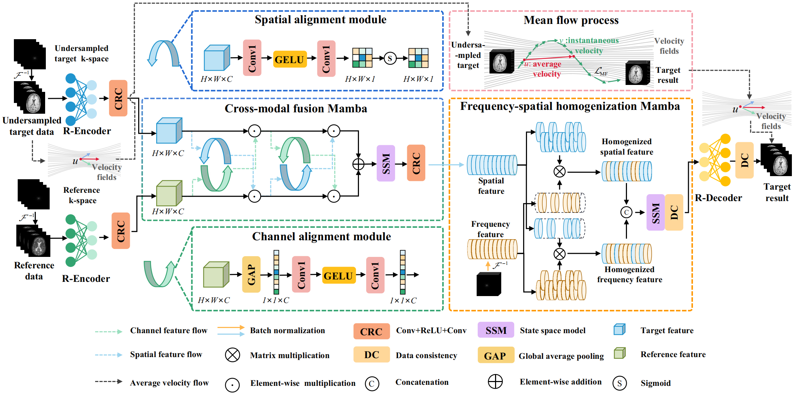

## Mean flow-informed proximal Mamba network with frequency-spatial homogenization for multi-modal MRI reconstruction


> **Abstract:**  Multi-modal magnetic resonance imaging (MRI) reconstruction aims to recover target-modality images from undersampled data by leveraging reference modalities as prior information. However, existing approaches often rely on point-to-point mappings, overlooking the optimization trajectory, which can degrade reconstruction accuracy. Moreover, spatial–frequency inconsistencies introduce redundant features, while insufficient cross-modal integration leads to structural distortions. To address these challenges, we propose a mean flow-informed proximal Mamba network (MF-IPM) with frequency–spatial homogenization. Specifically, MF-IPM combines a discrete reference-guided proximal reconstruction pathway with stage-wise mean flow supervision. The reconstruction pathway incorporates complementary reference-modality information, while the mean flow formulation provides average-velocity supervision at each unfolding stage during training. The mean flow loss is jointly optimized with the reconstruction objectives. The resulting architecture employs Mamba-based modules for cross-modal interaction and frequency-spatial feature modeling, followed by a final data-consistency layer that preserves the acquired target-modality measurements. For effective multi-modal fusion, we introduce the cross-modal fusion Mamba (CMFM) to enable bi-directional spatial–channel interaction and semantic alignment. Additionally, the frequency-spatial homogenization Mamba (FSHM) is proposed to suppress redundancy through joint spatial–frequency analysis using learnable homogenization factors. Extensive experiments on public and in-house datasets under various acceleration rates demonstrate the superiority of MF-IPM. Compared with the best competing results, MF-IPM achieves average gains of 0.60 dB in PSNR and 0.0060 in SSIM on the public datasets, and 0.57 dB in PSNR and 0.0054 in SSIM on the in-house datasets. The code is publicly available at https://github.com/algerhouston/MF-IPM.

⭐If this work is helpful for you, please help star this repo. Thanks!🤗


## 📑 Contents

- [Visual Results](#visual_results)
- [News](#news)
- [Results](#results)
- [Installation](#installation)
- [Datasets](#Datasets)
- [Citation](#cite)


## <a name="Real-SR"></a> 🥇 The proposed MF-IPM architecture


<p align="center">
    
</p>


## <a name="news"></a> 🆕 News

- **2026-7-11:** The code is being uploaded. 😄
- **2026-11-13:** The repository is updated to reflect the modifications in the revised manuscript. 📝

## <a name="results"></a>🔍 Results

We achieve state-of-the-art performance on various dataset. Detailed results can be found in the paper.

<details>
<summary>Evaluation on IXI dataset (click to expand)</summary>
<p align="center">
    
</p>
</details>

<details>
<summary>Evaluation on in-house dataset (click to expand)</summary>
<p align="center">
    
</p>
</details>

MF-IPM reconstruction results, reported as **PSNR (dB) / SSIM**. Values are means on the corresponding test sets. Standard deviations, comparisons with other methods, and experimental settings are provided in the paper.

| Sampling pattern | Acceleration | IXI | fastMRI | In-house brain | In-house shoulder |
|:--|:--:|:--:|:--:|:--:|:--:|
| Cartesian | ×4 | 39.64 / 0.987 | 37.58 / 0.975 | 38.98 / 0.989 | 38.03 / 0.980 |
| Cartesian | ×8 | 38.77 / 0.971 | 36.65 / 0.959 | 37.06 / 0.972 | 37.10 / 0.963 |
| Radial | ×4 | 39.12 / 0.982 | 37.08 / 0.970 | 38.49 / 0.981 | 37.53 / 0.971 |
| Radial | ×8 | 38.45 / 0.971 | 36.38 / 0.959 | 37.80 / 0.972 | 36.83 / 0.963 |
| Random point | ×4 | 39.22 / 0.983 | 37.11 / 0.971 | 38.49 / 0.985 | 37.56 / 0.975 |

## <a name="installation"></a> Installation

This codebase was tested with the following environment configurations. It may work with other versions.

- CUDA 11.7
- Python 3.9
- PyTorch 1.13.1 + cu117
- NVIDIA 4090 GPU (24 GB) and NVIDIA 5090 GPU (32 GB)

To use the selective scan with efficient hard-ware design, the `mamba_ssm` library is advised to install with the folllowing command.

```
pip install causal_conv1d==1.0.0
pip install mamba_ssm==1.0.1
```

One can also create a new anaconda environment, and then install necessary python libraries with this [requirement.txt](https://drive.google.com/file/) and the following command: 
```
conda install requirements.txt
```
## Datasets

The datasets used in our training and testing are orgnized as follows:

[IXI](http://brain-development.org/ixi-dataset/) dataset consists of nearly 600 MRIs from healthy subjects. The image acquisition protocol for each subject includes T1-weighted, T2-weighted, proton density (PD)-weighted images, as well as MRI and diffusion-weighted images. These data were collected across three different hospitals in London.

[FastMRI](https://fastmri.med.nyu.edu/) dataset is one of the largest open-source MRI datasets, providing raw fully sampled k-space data. It primarily includes knee and brain MRI scans with T1-weighted, T2-weighted, and proton density-weighted sequences.

The in-house clinical data were obtained from Gongli Hospital in the Shanghai Pudong New Area and included two datasets: brain and knee. These datasets were collected using the Vantage Titan 3.0T MRI scanner produced by Canon, Japan.

## <a name="cite"></a> 🥰 Citation

Please cite us if our work is useful for your research.


## Acknowledgement

This code is based on [BasicSR](https://github.com/XPixelGroup/BasicSR), [MeanFlow](https://github.com/zhuyu-cs/MeanFlow) ,and [Mamba](https://github.com/MzeroMiko/VMamba). Thanks for their awesome work.

## Contact

If you have any questions, feel free to approach me.


